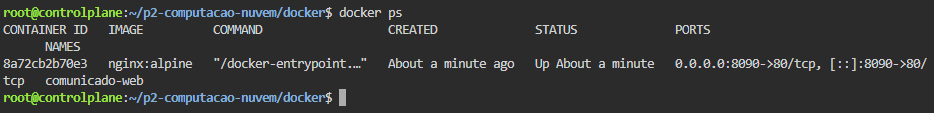
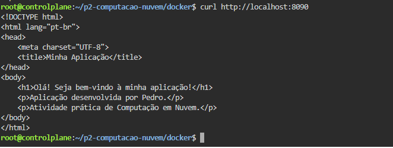
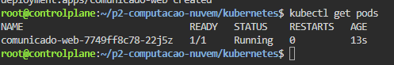
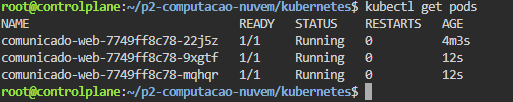
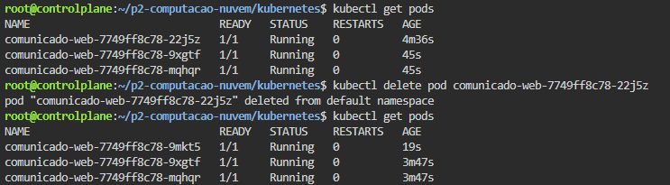
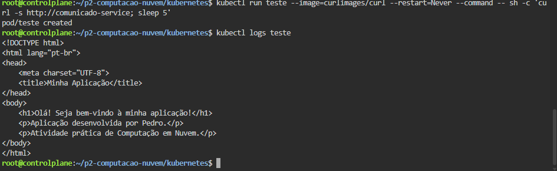

# P2 PROVA PRÁTICA COMPUTAÇÃO EM NUVEM

## 1.FUNDAMENTOS DA COMPUTAÇÂO EM NUVEM

### Questão 1 - Qual é a diferença entre IaaS e SaaS? Cite Um exemplo de Ultilização de cada Modelo.
* RESPOSTA:
  
A principal diferença entre IaaS (Infrastructure as a Service) e SaaS (Software as a Service) está no nível de gerenciamento e no que é entregue na nuvem: o IaaS fornece a infraestrutura base para você configurar e administrar seus sistemas, enquanto o SaaS entrega um software completo e pronto para uso

### Questão 2 - Uma Empresa ultiliza Servidores próprios e Também Recursos de um provedor de Nuvem pública. Qual Modelo de Implimentação em Nuvem essa empressa ultiliza? 
* RESPOSTA:
  
A Empresa usa Nuvem Hibrida, Esse modelo combina a infraestrutura local da própria empresa (nuvem privada ou servidores on-premises) com os serviços de um provedor de nuvem pública, permitindo que dados e aplicações sejam compartilhados entre ambos os ambientes.

### Questão 3 - Qual é a Principal diferença entre uma maquina virtual e um Contêiner?
* RESPOSTA:
  
A principal diferença está no nível de virtualização: uma máquina virtual (VM) virtualiza o hardware e inclui seu próprio sistema operacional completo, enquanto um contêiner virtualiza o sistema operacional e compartilha o kernel do sistema hospedeiro (host).

## 2.EXECUÇÃO DA APLICAÇÃO COM DOCKER

### Evidência 1 - Contêiner em Execução 

Comando Ultilizado :
Docker ps

 docker ps
 
CONTAINER ID   IMAGE     COMMAND   CREATED   STATUS    PORTS     NAMES

### Evidência 2 - Página Personalizada 

Comando Ultilizado :
Curl http://localhost:8090

## 3.EXECUÇÃO DA APLICAÇÃO NO KUBERNETS
### Evidência 3 - Deployment e Pod

Comando Ultilizado :
kubectl get pods

## 4.ESCABILIDADE E AUTORRECUPERAÇÃO 
### Evidência 4 - ESCABILIDADE 

Comando Ultilizado :
Kubectl scale deployment comunicado-we --replicas=3

kubectl get pods

### Evidência 5 - Autorrecuperação

Comando Ultilizado :
kubectl delete pod NOME_DO_POD

Kubectl get pods

## 5.DISPONIBILIZAÇÃO DA APLICAÇÃO 
### Evidência 6 - Service e acesso HTTP

Comando Ultilizado :
kubectl get services 

kubectl run teste --image=curLimagem/curl --rm -it --restart=Never --curl http://comunicado-service

 6.INTERPRETAÇÃO DOS RESULTADOS
 ### Questão 1 - Qual é a diferença entre uma Imagem Docker e um Contêiner em Execução ?
 * RESPOSTA:

### Questão 2 - Qual é a Função de Um Deployment no Kubernets?
 * RESPOSTA:

### Questão 3 - O que aconteceu quando você excluiu um Pod?Por Que isso aconteceu?
 * RESPOSTA:

### Questão 4 - Qual é a finalidade de um Service no Kubernetes ?
 * RESPOSTA:

### 7.CONCLUSÃO 

## 8.INDENTIFICAÇÃO DA ENTREGA 

#### PEDRO HENRIQUE PRIVADO ALVES
#### DATA DA REALIZAÇÃO 18/11/2026
